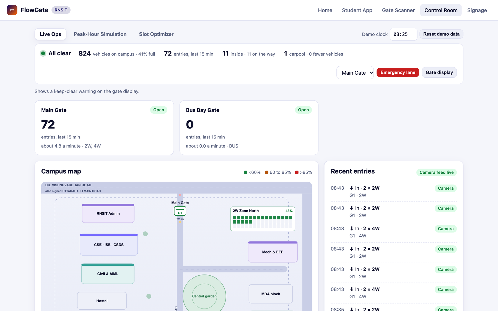

# FlowGate: smart campus traffic for RNSIT

Traffic near RNSIT jams during college entry and exit, and the reason is narrower than it looks: six RNS institutions share this campus, their start times overlap inside one hour, and there is only one vehicle gate for all of them. About 53 vehicles a minute arrive at a gate that clears 35. FlowGate spreads arrivals into staggered slots, pre-assigns parking and gates, forecasts gate queues and acts before they form, lets registered vehicles in hands-free, rewards good behaviour with green credits, and gives security a live control room, gate signage and a copilot.

> **Setting this up?** Simple install guide: **[docs/SETUP.md](docs/SETUP.md)**. Already have an older copy: **[START-HERE.md](START-HERE.md)**. Technical detail: **[docs/TECHNICAL.md](docs/TECHNICAL.md)**.



## Measured at RNSIT, not just modelled

On **13 November 2026** we filmed our own main gate during the morning peak and counted it with the same YOLOv8 script that ships in `yolo/`.

| Measured at the gate, 08:44 to 08:54 | |
|---|---|
| Footage counted | 5.8 minutes, 4K, 30 fps |
| Vehicles | **147** (121 two-wheelers, 22 cars, 4 buses) |
| Two-wheeler share | **82%** (we had assumed 89%) |
| Mean rate | 25 vehicles a minute |
| **Busiest minute** | **33 vehicles, one every 1.8 seconds** |
| Accuracy | a person counted the same 30 s by hand: **20 vs the software's 19** |

Three things this changed in the design:

1. **Nothing may ask a vehicle to stop at the gate.** At one vehicle every 1.8 seconds, a guard scanning a QR code per vehicle would become the bottleneck and make congestion worse. The QR pass is checked at the **parking area**, used for spot-checks, and kept as the fallback when a plate cannot be read. The gate stays free-flowing. Staggering arrivals is the only part of FlowGate that cuts load without adding a step at the gate.
2. **Number plates are a weak entry method here.** 82% of vehicles are two-wheelers, whose plates are small, angled and often obscured. Plate cameras belong on the car lanes later, not at the core of the design.
3. **A school shares our entrance.** The buses are RNS International School buses, so school drop-off lands inside the college peak. Any real timetable plan has to be agreed with the school too.

Full method, per-minute counts, every crossing time and the honest limits are in **[docs/measured/](docs/measured/)**, including why we do **not** quote a pedestrian figure. This is one entrance on one morning, and it is **not** interchangeable with the `88 vehicles/min` below, which counts students only.

## Run it

Needs **Node.js 22.13 or newer** (uses the built-in `node:sqlite`; tested on Node 24). The **core app needs no `npm install` and no internet**. On an older Node the server stops with a clear message.

```bash
node scripts/doctor.js
```

```bash
node server.js --reset
```

Open http://localhost:4000. The terminal also prints a LAN address so phones on the same Wi-Fi can open the student app.

- `node server.js` keeps existing data; `--reset` reseeds the demo data.
- `PORT=5000 node server.js` changes the port.
- Browser libraries are bundled in `public/lib/`, so the core demo works offline.
- Optional extras: `npm install` + `ANTHROPIC_API_KEY` for AI copilot answers (internet needed); Python for the camera scripts. See [docs/TECHNICAL.md](docs/TECHNICAL.md).
- Camera QR scanning needs `localhost` or HTTPS. A phone on the LAN (plain http) cannot use its camera: use the typed code or **Scan in**.

## What's inside

| Page | URL | What it does |
|---|---|---|
| Home | `/` | Pitch summary and simulated impact numbers |
| Student App | `/student` | Entry/exit slot, parking booking, QR pass, plate for hands-free entry, green credits, carpools, live notices |
| Gate Scanner | `/gate` | Scan QR by camera, typed code or tap; simulated number-plate (ANPR) reads |
| Control Room | `/admin` | **Live Ops** (map, gate feed, copilot, signage and emergency control, green-credit leaderboard), **Peak-Hour Simulation** (normal or stress day; today, FlowGate, FlowGate + Predict; 20-minute forecast), **Slot Optimizer** |
| Gate Signage | `/sign` | Full-screen TV display: gate to use, wait per gate, free parking, pedestrian signal, emergency lane |

### Features
1. **Staggered slots** (`src/optimizer.js`): each department-year cohort goes to the least loaded 10-minute window that still ends before its first class. Staggered exit windows start at or after each cohort's last class.
2. **Predictive gate control** (`src/simulator.js`, scenario `predictive`): every simulated minute, forecasts the combined gate queue 20 minutes ahead from planned arrivals (bookings) and incidents already reported. Above the threshold it sends a marshal to open an extra lane immediately and, if still needed, moves riders who have not left home into nearby minutes that genuinely have spare capacity, earlier or later, never past 08:50. The reactive `flowgate` scenario only sends the marshal once the queue reaches the road.
3. **Stress day**: rain (slower gates, 25% of riders switch to cars), only 60% follow their slot, and a breakdown in the gate mouth cutting the gate to one lane 08:15 to 08:35. There is one vehicle gate, so an incident there has nowhere to divert to.
4. **Parking pre-booking**: least utilised zone of the right type, routed to that zone's nearest gate.
5. **QR and hands-free entry**: QR pass scanned once in, once out; registered plates check in through `POST /api/gate/plate` (simulated reads in the demo).
6. **Green credits**: +10 for arriving in your slot, +10 for joining a carpool, +5 per rider for drivers; badges, priority parking at 150 points, department leaderboard.
7. **Carpool matching** by area and slot; drivers get the Carpool Priority zone.
8. **Gate signage and emergency lane**: a TV page any browser can show; the control room can flag an emergency lane.
9. **Copilot** (`src/copilot.js`): plain-English questions and shift reports. Uses Claude (`claude-opus-5-5`) when the SDK and a key are present; otherwise offline rule-based answers. Sends aggregates only.
10. **Live everything**: Server-Sent Events push scans, camera counts, simulation ticks and notices to every open screen.
11. **Camera counting** (`yolo/counter.py`, YOLOv8 + ByteTrack), run for real on our own campus footage: see [docs/measured/](docs/measured/). A fake camera stand-in is included for demos without video.

## API

| Method | Path | Body / query |
|---|---|---|
| GET | `/api/config` | gates, zones, demo clock |
| GET | `/api/users` | demo users |
| GET | `/api/me?userId=` | slot, booking, carpool, credits |
| POST | `/api/bookings` | `{userId}` |
| POST | `/api/bookings/cancel` | `{id}` |
| POST | `/api/gate/scan` | `{code, gateId}` |
| POST | `/api/gate/plate` | `{plate, gateId, source?: camera}` |
| GET | `/api/passes`, `/api/plates` | today's passes, registered plates (demo) |
| POST | `/api/counts` | `{gateId, direction: in/out, vehicleType: 2W/4W/BUS, count, source?: camera/simulated}` |
| GET | `/api/stats` | live ops snapshot |
| GET | `/api/credits?userId=`, `/api/leaderboard` | green credits |
| GET | `/api/carpool/matches?userId=` | ranked matches |
| POST | `/api/carpool/offer` / `/join` | `{userId, seats}` / `{userId, carpoolId}` |
| POST | `/api/optimizer/run` / `/apply` | `{cohorts?, params: {windowMin, bufferMin, earliestEntry}}` |
| GET | `/api/sim`, `/api/sim/days`, `/api/sim/compare?day=normal|stress` | sim state, days, three-scenario comparison |
| POST | `/api/sim/start` / `pause` / `reset` / `crossing` | `{scenario: baseline/flowgate/predictive, day, speed}` / `{gateId}` |
| POST | `/api/admin/emergency` | `{gateId, message?}` or `{}` to clear |
| GET / POST | `/api/copilot/status`, `/api/copilot` | `{question}` |
| POST | `/api/admin/demo-time` | `{time: "08:25"}` or `{}` for real clock |
| POST | `/api/admin/reset` | reseed demo data |
| GET | `/api/stream` | Server-Sent Events: `live`, `sim`, `scan`, `notice`, `schedule` |

## Assumptions (read before quoting numbers)

Everything in `src/config.js` and the constants at the top of `src/simulator.js` are **placeholder estimates, not verified RNSIT data** (the one exception is the measured section at the top of this file, which is real): zone capacities, class times, 80% slot compliance on a normal day, carpooling removing 30% of student cars under FlowGate, rain effects, the two-wheeler lane (+12/min) and the marshal lane (+10/min after 3 min), and the head counts for the school and the PU college. Demo people and plates are fictional.

Several inputs are **not** assumptions any more. The **AICTE sanctioned intake of 1,380 a year** comes from RNSIT's own mandatory disclosure (Oct 2025), giving 5,520 undergraduates plus 720 in MBA and MCA. The **school's start times** (08:00 for grades 5 to 10, 08:45 below that) are published by RNS International School, whose CBSE record gives its address as "RNSIT Campus". **82% two-wheelers** and a **gate capacity of at least 35 a minute** come from our own footage.

Two figures were calibrated against that footage rather than assumed: the arrival spread was widened from 5 minutes to 25, and the private-vehicle share was cut from 51% to 32%, because the first version of the model predicted a permanent jam at a gate we had filmed flowing freely at 33 a minute. A model that contradicts your own video is wrong.

Simulated results (seed 42):

| Normal day | Today | FlowGate |
|---|---|---|
| Gate capacity | 35 / min (one mixed lane) | 47 / min (two-wheeler lane added) |
| Peak queue at the gate | 311 vehicles | 3 |
| Worst wait at gate | 8.9 min | 0.5 min |
| Main-road spillback | 41 min | 0 min |
| Pedestrian conflict (peak index) | 42.3 | 14.1 |

| Stress day | Today | FlowGate (reactive) | FlowGate + Predict |
|---|---|---|---|
| Peak queue at the gate | 919 | 196 | **56** |
| Worst wait at gate | 32.8 min | 7.1 min | 2.0 min |
| Main-road spillback | 56 min | 28 min | 11 min |
| Marshal sent | never | 08:19 (queue forming) | 08:15 (at the incident) |

The forecast uses only the planned demand from bookings plus incidents once reported; it never sees the stress day's true demand. Ablation: on the stress day the nudge is deliberately small. It only drains minutes that are genuinely over capacity, and only into minutes with real room, so it moves 58 riders and the peak is the same with or without it. Almost all of the gain comes from the two-wheeler lane and from sending the marshal four minutes early. Earlier versions of the nudge made the peak **worse**, by pushing riders ten minutes later into a bigger wave; that is why the rule is now this conservative.

## Project layout

```
server.js            HTTP server, routes, SSE, simulator loop
src/config.js        campus assumptions (edit this first)
src/db.js            SQLite store: bookings, scans, plates, carpools, credits, seed data
src/optimizer.js     staggered slot optimizer
src/simulator.js     peak-hour simulator, stress day, predictive controller
src/copilot.js       Claude copilot with offline fallback
public/              student, gate, admin, sign pages (vanilla JS) + public/lib libraries
scripts/doctor.js    setup checker
yolo/                YOLOv8 counter (untested) + fake camera
docs/measured/       REAL measured gate data, 13 Nov 2026 (the only non-assumed numbers)
docs/                SETUP guide, abstract, demo script, screenshots, deck sources
```
